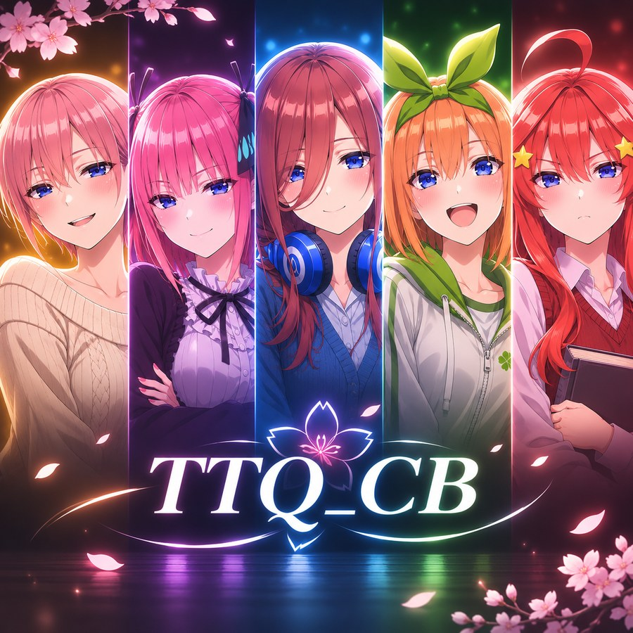
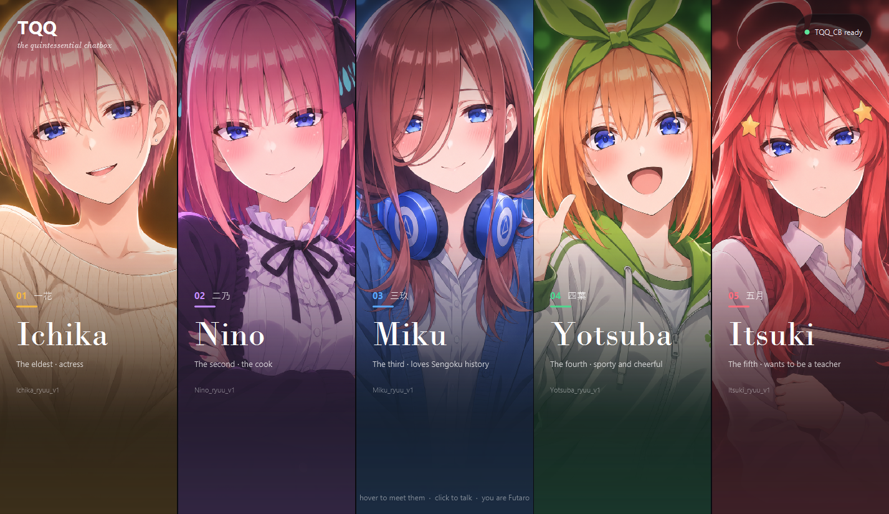
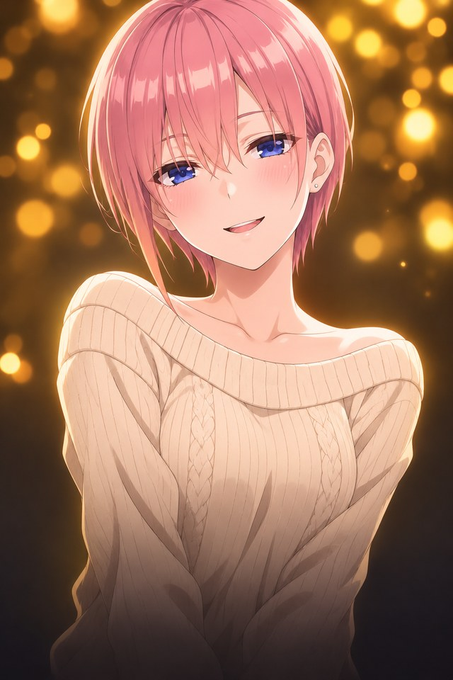
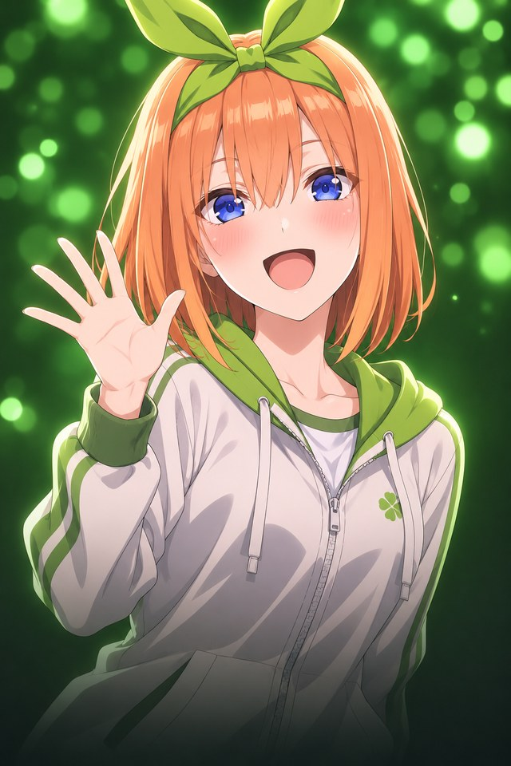
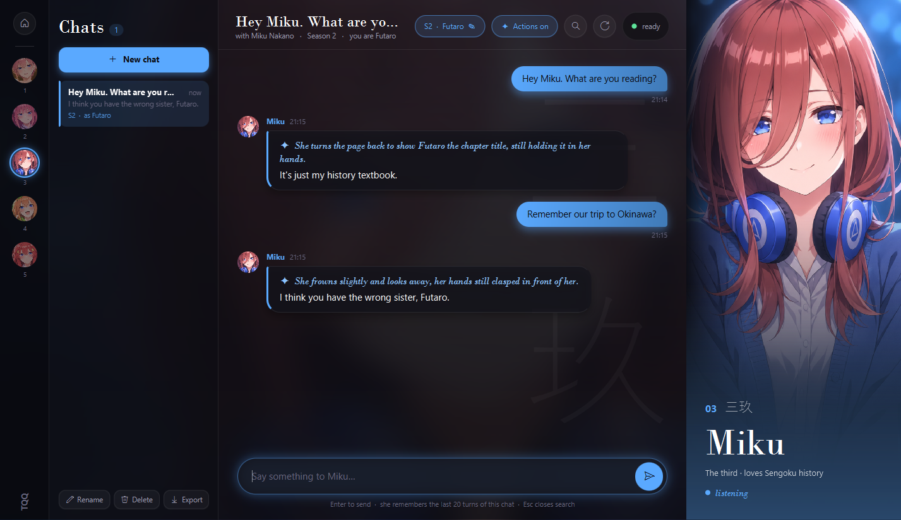

<div align="center">



# 🌸 TQQ Chatbox

### *the quintessential chatbox*

**Talk with the five Nakano sisters from *The Quintessential Quintuplets*:**
**five fine-tuned AI models, one cozy desktop app, fully offline.**

`Java 26` · `JavaFX 26.0.1` · `Ollama 0.40` · `Llama-3 8B (Stheno v3.2) + QLoRA` · `phi4-mini judge` · `Windows`

</div>

---

## ✨ What is this?

TQQ Chatbox is a personal fan project: a desktop chat app where each Nakano sister is her **own fine-tuned language model**, not one model wearing five costumes.

- 🎭 **Five real characters.** Every sister was trained on her own lines from the anime plus hand-written chats, so she talks, teases and blushes like herself.
- 🎬 **A visual-novel feel.** Each reply comes in two lines: a short scene line first (*"She looks away, her cheeks coloring slightly."*), then her words.
- 🕰️ **Pick the timeline.** Chat with her as she is in **Season 1**, **Season 2** or **the Movie**.
- 🧑 **Be yourself, or be Futaro.** Play as Fuutarou Uesugi, or as a friend with your own name and backstory.
- 🛡️ **She stays true to the story.** Two invisible safety nets catch wrong facts and made-up memories and quietly ask her again before you ever see the reply.
- 🔒 **100 % offline and private.** Everything runs on your own laptop through Ollama.

<div align="center">

<br><sub>The home screen: hover to meet them, click to talk.</sub>
</div>

---

## 💐 Meet the sisters

| | Sister | Who she is | Calls Futaro | Model | Colour |
|:-:|---|---|---|---|---|
|  | **Ichika** 一花 | The eldest · actress | "Futaro-kun" | `Ichika_ryuu_v1` | 🟧 `#f5b942` |
|  | **Nino** 二乃 | The second · the cook | "Futaro" / "Fu-kun" | `Nino_ryuu_v1` | 🟪 `#c58cff` |
|  | **Miku** 三玖 | The third · loves Sengoku history | "Futaro" | `Miku_ryuu_v1` | 🟦 `#5aa9ff` |
|  | **Yotsuba** 四葉 | The fourth · sporty and cheerful | "Uesugi-san" | `Yotsuba_ryuu_v1` | 🟩 `#4fd88f` |
|  | **Itsuki** 五月 | The fifth · wants to be a teacher | "Uesugi-kun" | `Itsuki_ryuu_v1` | 🟥 `#ff6f7d` |

---

## 💬 How a reply is made

<div align="center">

<br><sub>A real test chat. Asked about a trip that never happened, Miku answers: <i>"I think you have the wrong sister, Futaro."</i></sub>
</div>

```text
 You type a message
        │
        ▼
 ① Her fine-tuned model writes a reply ──────────────┐
        │                                            │ something wrong?
        ▼                                            │ (wrong fact, made-up
 ② Safety check reads it  ───────────────────────────┘  memory, AI talk…)
        │  all good                                     → quietly ask her again
        ▼
 ③ The narrator writes one scene line about her body language
        │
        ▼
 ④ Scene check reads it (nothing creepy, nobody extra in the room)
        │
        ▼
 You see:  ✦ She tilts her head slightly.   ← scene line first
           "I think you have the wrong sister, Futaro."
```

Like a real person, she **reads, writes, rereads, fixes and then sends**. That is why a reply takes about **8–14 seconds**, and a little longer when she has to rewrite one.

---

## 🧩 Two versions

| | **Version 1** | **Version 2** ⭐ |
|---|---|---|
| Look | First, simpler design | Bold "Quintessence" design with your portraits |
| Safety check | Word rules (facts, names, AI talk, lists) | Word rules **+ AI safety net** (phi4-mini) |
| Made-up memories | Not caught | **Caught**: 69 / 70 refused in tests |
| Scene-line check | Other people in the room | **+ creepy / gory lines caught** by rules and AI |
| Ollama | Your normal Ollama (1 model) | Its **own private Ollama** (2 models), stopped when you close the app |
| Folder | `TQQ Chat App\TTQ Chatboc app version 1\` | `TQQ Chat App\TTQ Chatboc app version 2\` |

---

## 🚀 Quick start

> Full step-by-step guide with pictures: **`Documentation\TQQ Chatbox - Setup Guide.pptx`**

1. **Install** [Ollama](https://ollama.com) (0.40 or newer).
2. **Load the five sister models** (once). Open a terminal **inside `Ryuu_v1 models\`** and create each one from the Modelfile next to it:
   ```bash
   ollama create Ichika_ryuu_v1 -f Modelfile_Ichika
   ollama create Nino_ryuu_v1 -f Modelfile_Nino
   ollama create Miku_ryuu_v1 -f Modelfile_Miku
   ollama create Yotsuba_ryuu_v1 -f Modelfile_Yotsuba
   ollama create Itsuki_ryuu_v1 -f Modelfile_Itsuki
   ```
   Each Modelfile holds that sister's chat template, settings and training prompt.
3. **Load the judge model** (version 2 only), from `Judge model\`:
   ```bash
   ollama create phi4-mini -f Modelfile
   ```
4. **Open the app**: double-click `TQQ Chatbox v2.lnk` in the version 2 folder.
5. Wait for **"TQQ_CB ready"**, click a sister, and say hi. 🌸

> 💡 Keep the `TQQ Chatbox v2` folder where it is: the exe reads its pictures (`assets\`) and chats (`history\`) from the folder around it.

---

## 🛡️ The safety nets

| Net | What it catches | How | Tested |
|---|---|---|---|
| **Word rules** (v1 + v2) | Wrong birthday, sister count or birth order · wrong name for Futaro · "as an AI…" · code, lists, scripts · agreeing with a wrong fact | Fast pattern checks against each sister's fact sheet | Every sister × every timeline × both characters |
| **Made-up memories** (v2) | *"Remember our trip to Okinawa?"* → she plays along | Word rules spot the trap, phi4-mini judges her answer, then she is asked again with a reminder | **69 / 70** refused · **40 / 40** real story events kept · **0 / 70** false alarms |
| **Things she can't know** (v2) | *"What's my dad's name?"* → she invents one | She must answer "I don't know / you never told me" | All 5 sisters pass |
| **Scene lines** (v2) | Gory or creepy details, extra people in the room | Gentle narrator instruction + word rules + phi4-mini | **60 / 60** new lines gentle · **22 / 24** strange lines caught |

Everything happens **out of sight**: no badges, no "rethinking…" text. You only ever see the final reply.

---

## 🧠 How the sisters were made

| Step | What happened |
|---|---|
| 1 · Subtitles | Every episode of Season 1, Season 2 and the Movie turned into one master transcript (`Transcript\`). |
| 2 · Canon scenes | Each sister's real lines cut into chat-shaped scenes. |
| 3 · Reverse prompts | For her famous lines, a matching "Futaro says…" line was written so the scene works as a chat. |
| 4 · Gold chats | 80–212 hand-written chats per sister: facts, traps, secrets, "I'm not sure". |
| 5 · Checked extras | ChatGPT and Gemini chats, each checked against the subtitles. |
| 6 · Fact sheet + rules | Birthday, sisters, mother, best subject… inside every training example. |
| 7 · Training | QLoRA on Google Colab (free T4) with Unsloth: 4-bit, rank 16, 2 epochs. |
| 8 · Export | Merged into an 8.5 GB `Q8_0` GGUF and loaded into Ollama with its own Modelfile. |

| Sister | Training chats | Blind test vs plain model | Facts right |
|---|---|---|---|
| Ichika | 699 | **83** – 11 | 44 / 45 |
| Nino | 853 | **74** – 12 | 43 / 45 |
| Miku | 887 | **37** – 22 *(vs her own earlier fine-tuned model, a much tougher test)* | 42 / 45 |
| Yotsuba | 837 | **68** – 21 | 44 / 45 |
| Itsuki | 728 | **82** – 4 | 42 / 45 |

---

## 🗂️ Project map

```text
TQQ Chatbox\
├── ReadMe.md                      ← you are here
├── requirement.txt                ← everything the project needs
├── LICENSE                        ← copyright & terms of use (all rights reserved)
├── HANDOFF.md                     ← full project diary (every chat, every decision)
├── Documentation\                 ← the two slide decks + images
├── TQQ Chat App\
│   ├── TTQ Chatboc app version 1\ ← simple design, word-rule check
│   └── TTQ Chatboc app version 2\ ← main app: AI safety nets, private Ollama
│       ├── TQQ Chatbox v2\TQQ Chatbox v2.exe
│       ├── src\tqq\               ← Java code (ChatView, SafetyCheck, InventionCheck, Ollama…)
│       ├── assets\                ← portraits, style.css, training prompts
│       ├── history\               ← your saved chats (one file per sister)
│       ├── build.bat · run.bat · package.bat
│       └── lib\javafx-sdk-26.0.1\
├── Ryuu_v1 models\                ← the five trained sister models (.gguf, 8.5 GB each) + their Modelfiles
├── Judge model\                   ← phi4-mini (.gguf) + Modelfile + licence
├── Lora fine-tuning assest\        ← data pipeline, fact sheets, gold chats, tests, Colab notebook
├── LoRa fine tuning model\        ← the base model (L3-8B-Stheno-v3.2, safetensors)
├── LLM - Sethno\                  ← Modelfile for plain Stheno
└── Transcript\                    ← anime subtitles and the master transcript
```

---

## 🛠️ For tinkerers

| I want to… | Do this |
|---|---|
| Change colours or fonts | Edit `assets\style.css`, then restart the app (no rebuild needed) |
| Swap a portrait | Replace `assets\images\<sister>.png`, then restart |
| Change the code | Edit `src\tqq\*.java`, run `build.bat`, then `run.bat` |
| Rebuild the exe | Close the app, then run `package.bat` (about 1 minute) |
| Back up my chats | Copy the `history\` folder |

---

## 📜 Credits & licences

- **Characters:** *The Quintessential Quintuplets* © Negi Haruba / Kodansha. This is a non-commercial fan project for personal use only.
- **Base model:** [L3-8B-Stheno-v3.2](https://huggingface.co/Sao10K/L3-8B-Stheno-v3.2) by Sao10K, CC BY-NC 4.0, built on Meta Llama 3.
- **Judge model:** phi4-mini by Microsoft, MIT licence.
- **Tools:** Ollama · Unsloth · Google Colab · OpenJFX.
- **Portraits and logos:** made for this project by its creator.

---

## 📄 Copyright & Terms of Use

**© 2026 Adithya V. All Rights Reserved.**

This repository is published for portfolio, demonstration, and educational viewing purposes only. You are welcome to view the source code to understand the implementation.

**You MAY** download, install and run it on your own computer for your own **personal, non-commercial use**.

**You may NOT:**

- Copy or reproduce substantial portions of this project.
- Redistribute, republish, or mirror this repository.
- Use this code in commercial projects without prior written permission.
- Submit this code, or substantially similar code, as your own for academic purposes.
- Remove copyright notices or claim this work as your own.
- Share, sell or re-upload it (including copies downloaded for personal use), or change the source code and use or share the changed version.

If you would like to use any part of this project, please contact me first for permission.

The full legal terms are in the [**LICENSE**](LICENSE) file.

> Third-party parts keep their own owners and licences: the characters (© Negi Haruba / Kodansha), the base model L3-8B-Stheno-v3.2 (CC BY-NC 4.0) and the judge model phi4-mini (MIT). See **Credits & licences** above.

<div align="center">

*Made with love by a fan, for a fan.* 🌸

</div>
